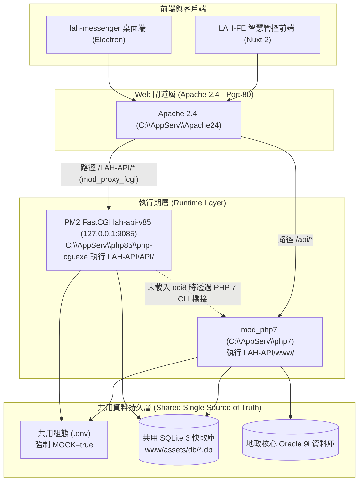

# LAH-API 專案架構與 Agent 治理契約

> **適用範圍**：本儲存庫根目錄及其轄下之 `www/` 與 `API/` 雙軌子目錄。  
> **核心目標**：規範 AI Agent 在維護舊版 PHP 7.3/7.4 API 與推進 PHP 8.5 漸進式移植時的邊界、相容性原則與安全防護機制。

---

## 1. 雙軌架構拓撲與目錄職責

`LAH-API` 目前處於**「雙軌並行、平滑演進」**階段，由 Apache 2.4 作為主要分流閘道：

| 目錄 | 軌道角色 | 執行環境與技術棧 | 路由與監聽埠 | 適用 Agent 規範 |
|---|---|---|---|---|
| `./www/` | **線上生產軌道 (Legacy Production)** | PHP 7.3 / 7.4、Apache `mod_php7`、Oracle 9i (OCI8)、SQLite 3 | `http://127.0.0.1/api/*.php` (Port 80) | 參閱 [`www/AGENTS.md`](file:///c:/Temp/DEV/LAH-Workspace/LAH-API/www/AGENTS.md) |
| `./API/` | **現代化移植軌道 (PHP 8.5 Migration)** | PHP 8.5.12 NTS、PM2 FastCGI 守護 (`php-cgi.exe`)、智慧雙模連線 | `http://127.0.0.1/LAH-API/api/*.php` (Port 9085 轉發) | 參閱 [`API/AGENTS.md`](file:///c:/Temp/DEV/LAH-Workspace/LAH-API/API/AGENTS.md) |

### 1.1 架構資料流向

---

## 2. 跨目錄邊界與單一真實來源鐵律

Agent 在進行開發、修復或移植工作時，必須嚴格遵守以下系統邊界：

### 2.1 單向移植隔離（One-way Migration Boundary）
- **進行 `API/` 任務時**：
  - 只能從 `www/`「單向讀取」原始碼，並複製到 `API/` 進行 PHP 8.5 相容性修正。
  - **嚴格禁止修改 `www/` 內的任何檔案**，確保線上現有 PHP 7.3/7.4 服務 100% 零風險、零變更。
- **進行 `www/` 任務時**：
  - 專注於修復既有問題，嚴格遵守 PHP 7.3 語法限制，不得引入 PHP 7.4+ / 8.x 新語法。

### 2.2 共用資源單一真實來源（Single Source of Truth）
- **環境設定檔 (`.env`)**：
  - 全專案唯一設定檔為 [`www/.env`](file:///c:/Temp/DEV/LAH-Workspace/LAH-API/www/.env)。
  - `API/include/Env.class.php` 與 `GlobalConstants.inc.php` 預設直接讀取 `ROOT_DIR . '/.env'`（即 `www/.env`）。
  - **嚴格禁止在 `API/` 建立獨立的 `.env` 檔案**。
  - **強制 MOCK 模式**：除非人工明確書面授權，否則 `www/.env` 中的 `MOCK=true` 嚴禁被改為 `false` 或註解。
- **SQLite 本地快取與業務資料庫**：
  - 兩軌一律共用 [`www/assets/db/*.db`](file:///c:/Temp/DEV/LAH-Workspace/LAH-API/www/assets/db/) 實體檔案。
  - **嚴格禁止在 `API/` 建立資料庫複本**，以防本地資料狀態發生雙向漂移。
- **日誌與匯出目錄**：
  - 兩軌一律共用 `www/log/`、`www/export/` 與 `www/import/`。

---

## 3. 子目錄 Agent 規範分流指引

當 Agent 執行任務時，應依據工作目標切換至對應的規範手冊：

1. **若任務涉及既有線上功能維護、舊版 PHP 7.3 業務修復**：
   👉 請遵循 [`www/AGENTS.md`](file:///c:/Temp/DEV/LAH-Workspace/LAH-API/www/AGENTS.md)。
   - 重點：保守維護、禁用 PHP 7.4+/8.x 語法、Minimal Diff。
2. **若任務涉及 PHP 8.5 移植、新版 API 端點重整或效能測試**：
   👉 請遵循 [`API/AGENTS.md`](file:///c:/Temp/DEV/LAH-Workspace/LAH-API/API/AGENTS.md)。
   - 重點：最小差異相容移植、修復 P0 `bindParam` 傳址錯誤、消除 P1 棄用警告、Oracle 9i 雙模橋接規範。

---

## 4. 變更前快速檢查清單

開始任何程式碼修改前：
- [ ] 確認目前修改目標路徑屬於 `www/` 還是 `API/`。
- [ ] 若為 `API/` 任務，確認不會修改到 `www/` 的任何既有檔案。
- [ ] 確認 `www/.env` 中 `MOCK=true` 依然維持開啟。
- [ ] 遵循台灣繁體中文撰寫技術報告與 Conventional Commits。
