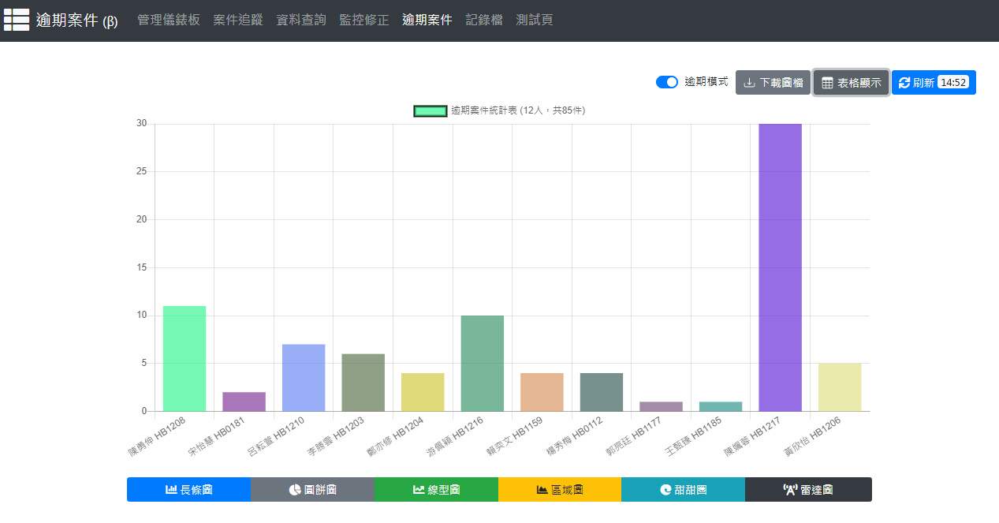
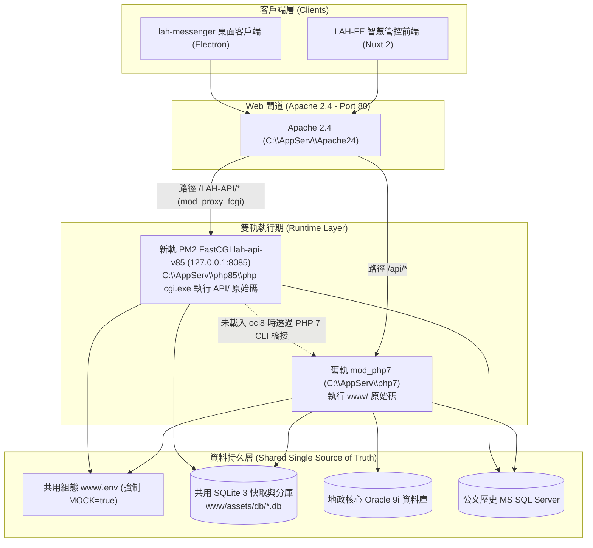

# LAH-API

> 地政中台核心 Web API 服務 (A WEB API for LAH-FE & lah-messenger)



---

## 📖 目錄 (Table of Contents)

- [1. 專案簡介 (Introduction)](#1-專案簡介-introduction)
- [2. 系統架構與雙軌並行 (System Architecture & Dual-Track)](#2-系統架構與雙軌並行-system-architecture--dual-track)
  - [2.1 雙軌架構概覽 (PHP 7.4 vs PHP 8.5)](#21-雙軌架構概覽-php-74-vs-php-85)
  - [2.2 資料庫整合能力](#22-資料庫整合能力)
- [3. 目錄結構說明 (Directory Layout)](#3-目錄結構說明-directory-layout)
- [4. 快速安裝與環境建置 (Quick Start & Installation)](#4-快速安裝與環境建置-quick-start--installation)
  - [English Installation Guide](#english-installation-guide)
  - [中文手動安裝說明（Windows x64 標準環境）](#中文手動安裝說明windows-x64-標準環境)
- [5. 環境變數設定與 MOCK 模式 (.env & Configuration)](#5-環境變數設定與-mock-模式-env--configuration)
- [6. 核心 API 模組一覽 (API Modules Overview)](#6-核心-api-模組一覽-api-modules-overview)
- [7. 本機開發與聯調 (Local Development)](#7-本機開發與聯調-local-development)
- [8. 注意事項 (Notes & Limitations)](#8-注意事項-notes--limitations)

---

## 1. 專案簡介 (Introduction)

`LAH-API` 為地政整合中台後端 API 伺服器，主要為以下客戶端提供高可用性、快取加速與異質資料庫存取服務：

- **網頁端前端**：`LAH-FE` (Nuxt.js 2 + BootstrapVue v2 前端管理工作台)
- **桌面應用端**：`lah-messenger` (Electron + Nuxt 2 桌面即時通訊程式)
- **即時通訊推播服務**：`lah-messenger-server` (LAH-WSS Node.js 原生 WebSocket 伺服器)
- **周邊自動化腳本**：包含航空城地籍清冊整理、印表機監控、Tomcat 代理及 Watchdog 服務

---

## 2. 系統架構與雙軌並行 (System Architecture & Dual-Track)

本專案現正推行**「雙軌並行、平滑升級」**架構，兼顧線上既有地政業務穩定與 PHP 現代化遷移：

### 2.1 雙軌架構概覽 (PHP 7.4 vs PHP 8.5)

| 軌道 | 目錄 | 執行期與處理器 | 監聽埠 / 路由 | 主要職責與特點 |
| :--- | :--- | :--- | :--- | :--- |
| **線上生產軌道<br>(Legacy)** | `www/` | Apache `mod_php7`<br>(PHP 7.4.33 ZTS) | `http://127.0.0.1/api/*`<br>(Port 80) | 承擔現行線上穩定生產流量，嚴格遵守 PHP 7.3 保守相容性。詳見 [`www/AGENTS.md`](www/AGENTS.md)。 |
| **現代化移植軌道<br>(Migration)** | `API/` | PM2 FastCGI 守護<br>(PHP 8.5.12 NTS) | `http://127.0.0.1/LAH-API/v1/*`<br>(Port 8085 轉發，相容 `/api/*`) | 漸進式移植核心 API，修正 P0/P1 相容性，具備 FastCGI 16 程序併發與 Oracle 9i 雙模連線。詳見 [`API/README.md`](API/README.md)。 |



### 2.2 資料庫整合能力

| 資料庫類型 | 驅動 / 擴充 | 用途說明 |
| :--- | :--- | :--- |
| **Oracle Database** | `php_oci8_11g.dll` (www) / 雙模橋接 (v85) | 核心地政業務資料庫（包含主要 HXWEB、備份 BACKUP、測試 HXT，以及 L1HWEB/L2HWEB/L3HWEB 跨所同步庫） |
| **Microsoft SQL Server** | `php_sqlsrv.dll` / `pdo_odbc` | 舊版公文管理、差勤與歷史紀錄查詢庫（`MS_DB_*`, `MS_DOC_DB_*`, `MS_TDOC_DB_*`） |
| **SQLite 3** | `pdo_sqlite` / `sqlite3` | 本地快取（`cache.db`）、代碼檔（`RKEYN.db`）、IP解析（`IPResolver.db`）、維度資料與系統備份設定（`dimension.db`） |

---

## 3. 目錄結構說明 (Directory Layout)

```text
LAH-API/
├── README.md               # 專案雙軌主說明文件（本文件）
├── AGENTS.md               # AI Agent 專案分層治理總則（定義雙軌邊界與單一真實來源）
├── installation.txt        # 手動部署設定筆記
├── php.ini-ref             # 產線 php.ini 參考配置
├── httpd.conf-ref          # 產線 Apache httpd.conf 參考配置
├── snap.jpg                # 系統儀表板畫面預覽
│
├── www/                    # [舊軌] 線上正式 DocumentRoot (PHP 7.4 執行目錄)
│   ├── AGENTS.md           # PHP 7.3 線上生產維護規範 (保守維護與最小變更)
│   ├── .env.example        # 全專案共用環境變數範本 (35+ 項非 MSSQL 設定)
│   ├── .env                # 全專案唯一設定檔 (受 .gitignore 保護，強制 MOCK=true)
│   ├── composer.json       # PHP 7 依賴宣告 (PhpSpreadsheet ^1.14 等)
│   ├── run_dev_http.bat    # 本機開發用內建 HTTP 快速啟動腳本
│   ├── api/                # 既有線上 API 進入點 (共 30+ 支業務 RESTful/JSON API)
│   ├── include/            # 既有業務邏輯類別庫 (init.php, System, OraDB 等)
│   ├── assets/             # 全專案共用資源目錄 (全軌道共用單一真實來源)
│   │   ├── db/             # 共用 SQLite 本地快取與資料庫目錄 (*.db)
│   │   ├── img/            # 圖檔與使用者大頭照目錄
│   │   ├── files/          # SQL 樣板檔 (.tpl) 與法規參考文件
│   │   └── xlsx/           # 統計報表匯出 Excel 樣板
│   ├── import/             # 共用批次排程匯入目錄
│   ├── export/             # 共用匯出暫存目錄
│   └── log/                # 共用日誌目錄
│
└── API/                    # [新軌] 現代化移植目錄 (PHP 8.5 FastCGI 服務)
    ├── README.md           # PHP 8.5 移植與雙軌架構技術手冊
    ├── migration.html      # 離線可列印移植技術手冊 (含 Oracle 12c 升級備忘錄)
    ├── deploy_php85_guide.html # 離線可列印部署與 Apache 轉址指南
    ├── DEPLOY_PHP85_APACHE_GUIDE.md # 伺服器部署與轉址維運手冊
    ├── install_php85.ps1   # 一鍵自動化下載安裝與轉址設定腳本
    ├── AGENTS.md           # PHP 8.5 移植規範 (最小差異移植、P0/P1 修復與驗證清單)
    ├── ecosystem.config.js # PM2 FastCGI 行程守護設定檔 (lah-api-v85, 16 併發子程序)
    ├── composer.json       # PHP 8.5 依賴宣告 (PhpSpreadsheet ^2.0)
    ├── ver.php             # 雙軌健康檢查與模組探針 API (http://127.0.0.1/LAH-API/ver.php)
    ├── v1/                 # 已完成 PHP 8.5 移植之核心端點 (/LAH-API/v1/*.php，相容 /api/)
    └── include/            # 已修復 PHP 8.5 相容之核心類別庫 (含 OraDB 智慧雙模橋接)
```

---

## 4. 快速安裝與環境建置 (Quick Start & Installation)

各地政事務所伺服器建議全面收斂至 **`C:\AppServ`** 標準架構目錄：

### English Installation Guide

1. **Server Root Layout**:
   - Apache 2.4: `C:\AppServ\Apache24`
   - PHP 7 (Legacy): `C:\AppServ\php7`
   - PHP 8.5 (Modern): `C:\AppServ\php85`
   - Production Root (www): `C:\AppServ\www`
   - Migration Target (v85): `C:\AppServ\LAH-API`
2. **Oracle Instant Client**:
   - Extract `instantclient_11_2` to `C:\Tools\instantclient_11_2`.
   - Add `C:\AppServ\Apache24\bin`, `C:\AppServ\php7`, `C:\AppServ\php85`, and `C:\Tools\instantclient_11_2` to System `PATH`.
3. **Configure Apache (`httpd.conf`)**:
   - Point `DocumentRoot` to `C:/AppServ/www`.
   - Enable `mod_proxy` & `mod_proxy_fcgi` and set `Alias /LAH-API "C:/AppServ/LAH-API"`.
   - Forward `/LAH-API/*.php` to `fcgi://127.0.0.1:8085/`.
4. **Start Services**:
   - Start Apache: `httpd.exe -k start`.
   - Start PM2 FastCGI: `cd C:\AppServ\LAH-API && pm2 start ecosystem.config.js && pm2 save`.

---

### 中文手動安裝說明（Windows x64 標準環境）

#### 步驟 1：安裝環境與目錄配置
各所標準安裝路徑：
- Apache 2.4 (x64)：`C:\AppServ\Apache24`
- PHP 7.4 (Thread Safe x64)：`C:\AppServ\php7`
- PHP 8.5 (Non Thread Safe x64)：`C:\AppServ\php85`
- Oracle Instant Client：`C:\Tools\instantclient_11_2`

#### 步驟 2：設定系統環境變數 (System PATH)
將下列路徑加入 Windows 系統環境變數的 `Path` 中：
1. `C:\AppServ\Apache24\bin`
2. `C:\AppServ\php7`
3. `C:\AppServ\php85`
4. `C:\Tools\instantclient_11_2`

#### 步驟 3：設定 `php.ini`
1. **PHP 7 (`C:\AppServ\php7\php.ini`)**：
   ```ini
   extension_dir = "C:/AppServ/php7/ext"
   extension=curl
   extension=fileinfo
   extension=gd2
   extension=intl
   extension=mbstring
   extension=openssl
   extension=pdo_sqlite
   extension=sqlite3
   extension=sockets
   extension=oci8_11g
   extension=sqlsrv_74_ts
   ```
2. **PHP 8.5 (`C:\AppServ\php85\php.ini`)**：
   ```ini
   extension_dir = "ext"
   extension=curl
   extension=fileinfo
   extension=gd
   extension=intl
   extension=mbstring
   extension=odbc
   extension=openssl
   extension=pdo_odbc
   extension=pdo_sqlite
   extension=sqlite3
   extension=sockets
   extension=zip
   ```

#### 步驟 4：設定 Apache `httpd.conf`
編輯 `C:\AppServ\Apache24\conf\httpd.conf`：
1. 載入 PHP 7 內嵌模組：
   ```apache
   Define SRVROOT "C:/AppServ/Apache24"
   ServerRoot "${SRVROOT}"
   LoadFile "C:/AppServ/php7/php7ts.dll"
   LoadModule php7_module "C:/AppServ/php7/php7apache2_4.dll"
   PHPIniDir "C:/AppServ/php7"
   DocumentRoot "C:/AppServ/www"
   ```
2. 啟用 FastCGI 模組並設定 `/v85` 雙軌分流：
   ```apache
   LoadModule proxy_module modules/mod_proxy.so
   LoadModule proxy_fcgi_module modules/mod_proxy_fcgi.so

   Alias /LAH-API "C:/AppServ/LAH-API"
   <Directory "C:/AppServ/LAH-API">
       Header set Access-Control-Allow-Origin "*"
       Options -Indexes +FollowSymLinks
       AllowOverride None
       Require all granted

       # 安全防護：禁止直接存取機敏副檔名檔案
       <FilesMatch "^\.|\.(json|lock|xml|bat|ps1|md|ini|config|yml|yaml)$">
           Require all denied
       </FilesMatch>

       <FilesMatch "\.php$">
           <If "-f %{REQUEST_FILENAME}">
               SetHandler "proxy:fcgi://127.0.0.1:8085/"
               ProxyFCGISetEnvIf "reqenv('SCRIPT_FILENAME') =~ m#^proxy:fcgi://127\.0\.0\.1:8085/(.*)$#" SCRIPT_FILENAME "$1"
           </If>
       </FilesMatch>
   </Directory>

   # 安全防護：禁止直接存取內部核心目錄
   <Directory "C:/AppServ/LAH-API/include">
       Require all denied
   </Directory>

   <Directory "C:/AppServ/LAH-API/tests">
       Require all denied
   </Directory>

   <Directory "C:/AppServ/LAH-API/vendor">
       Require all denied
   </Directory>

   <Proxy "fcgi://127.0.0.1:8085/" enablereuse=on max=16>
       ProxySet timeout=300
   </Proxy>
   ```

#### 步驟 5：啟動服務與開機自啟
1. **啟動 Apache 服務**：
   ```powershell
   httpd.exe -k start
   ```
2. **啟動 PHP 8.5 FastCGI (PM2)**：
   ```powershell
   cd C:\AppServ\LAH-API
   pm2 start ecosystem.config.js
   pm2 save
   ```

---

## 5. 環境變數設定與 MOCK 模式 (.env & Configuration)

全專案統一以 [`www/.env`](www/.env) 作為單一真實來源，`v85/` 透過共用機制自動讀取，嚴禁建立獨立副本：

### 5.1 設定方式
1. 複製 `www/.env.example` 為 `www/.env`：
   ```bash
   cp www/.env.example www/.env
   ```
2. 編輯 `www/.env` 填入該主機站台所屬之 Oracle IP、所別代碼、WebAP 門檻與金鑰。

### 5.2 MOCK 模式（開發與離線安全防護）
在 `www/.env` 中控制 MOCK 開關：
```ini
# 開啟 MOCK 模式（支援 true, false, 1, 0）
MOCK=true
```
- **MOCK 開啟時**：所有地政查詢 API 優先讀取本地 SQLite 快取或回傳模擬資料，並自動注入本機測試管理者權限。
- **Agent 約束**：使用 Agent 進行開發協作時，`MOCK=true` 強制保持開啟，嚴禁未經授權連線實體 Oracle。

---

## 6. 核心 API 模組一覽 (API Modules Overview)

API 端點遵循標準 JSON 回應協定：
```json
{
  "status": 1,
  "message": "處理成功訊息",
  "raw": { ... }
}
```

| API 端點 (舊軌 `/api/` ； 新軌 `/LAH-API/v1/`，相容 `/LAH-API/api/`) | 主要功能 | 說明 |
| :--- | :--- | :--- |
| `auth_json_api.php` | 登入與身份驗證 | 使用者權限驗證、IP 登入檢查與 WebSocket 資訊獲取 |
| `query_json_api.php` | 綜合資訊與設定查詢 | 查詢 `configs` 系統參數、綜合看板統計、快照歷史 |
| `system_json_api.php` | 系統模式與代碼維護 | 切換 MOCK/MSSQL 模式、全縣事務所代碼、使用者名冊同步 |
| `reg_json_api.php` | 登記案件管理 | 逾期管制、未歸檔案件追蹤、地籍異動與外國人地權管控 |
| `sur_json_api.php` | 測量案件業務 | 建物滅失追蹤管制、測量延期管制與會同辦理案件查詢 |
| `moicas_json_api.php` | 地政核心系統介接 | MOICAS 案件跨所、跨縣市、跨域代收代寄與智慧控管系統查詢 |
| `notification_json_api.php`| 訊息與公告通知 | 公告推播、課室廣播紀錄回溯與附檔自動關聯讀取 |
| `stats_json_api.php` | 業務統計看板 | 今日案件、各所跨所業務量、謄本核發量即時統計 |
| `export_xlsx_api.php` | Excel 報表匯出 | 統計數據轉化並套用官方樣板匯出 Excel 活頁簿 |
| `export_txt_data.php` | 地籍匯出與資料打包 | 支援大筆地籍文字檔產出、ZIP 壓縮串流下載與定時清理 |

---

## 7. 本機開發與聯調 (Local Development)

### 方式 A：一鍵啟動工作區整合開發環境（推薦）
雙擊或於終端機執行根目錄快捷腳本：
```powershell
.\start_dev.bat
```
腳本會自動檢查並啟動 Apache（Port 80）、前端 `LAH-FE`（Port 8080）與即時通推播伺服器 `lah-messenger-server`（Port 8081/8082），並於背景保持 PM2 託管之 `lah-api-v85`（Port 8085）。

### 方式 B：雙軌獨立啟動與驗證

1. **舊軌 (PHP 7.4) 獨立測試**：
   - 瀏覽器開啟 `http://127.0.0.1/ver.php` 確認顯示 PHP 7.4.33。
   - 若不開 Apache，可進入 `www/` 執行內建伺服器：`cd www && run_dev_http.bat`。
2. **新軌 (PHP 8.5) 獨立測試**：
   - 確認 PM2 守護狀態：`pm2 status`（確認 `lah-api-v85` 為 `online`）。
   - 瀏覽器開啟 `http://127.0.0.1/LAH-API/ver.php` 確認回傳 `"channel": "LAH-API"`, `"php_version": "8.5.12"`。
   - 若欲單獨除錯 PHP 8.5：
     ```powershell
     C:\AppServ\php85\php.exe -S 127.0.0.1:8085 -t C:\AppServ\LAH-API
     ```
     瀏覽器開啟 `http://127.0.0.1:8085/ver.php`。

---

## 8. 注意事項 (Notes & Limitations)

- **不支援 Internet Explorer (NO IE support)**：系統採用現代標準規範（RFC 5987 UTF-8、Fetch/Axios 等），全面停止支援 IE。
- **Windows 檔案編碼**：專案內部腳本全面採用 **UTF-8（無 BOM）** 編碼。
- **環境變數安全性**：`www/.env` 包含資料庫密碼與 API 金鑰，已列入 `.gitignore`，切勿推播至公開儲存庫。
- **雙軌遷移參考指引**：詳細 PHP 8.5 移植步驟、Oracle 9i 雙模連線與 Oracle 12c 升級備忘，請參閱 [`API/README.md`](API/README.md) 與 [`API/migration.html`](API/migration.html)。伺服器環境建置與 Apache 轉址請參閱 [`API/DEPLOY_PHP85_APACHE_GUIDE.md`](API/DEPLOY_PHP85_APACHE_GUIDE.md)。
