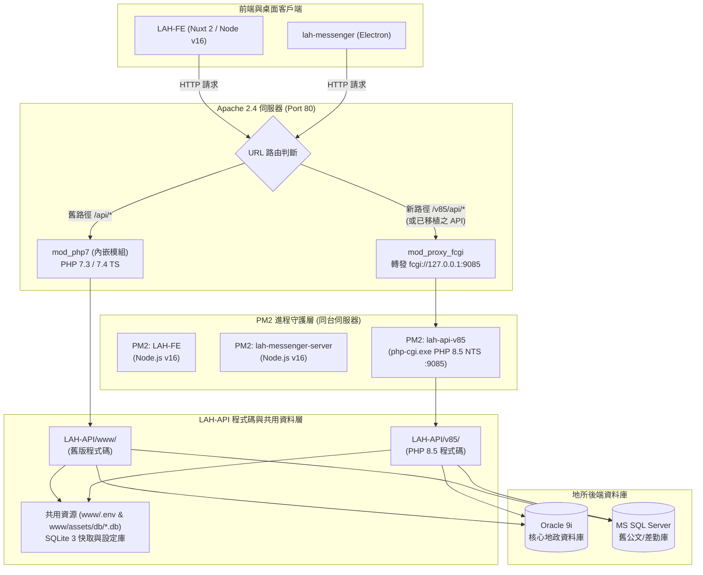
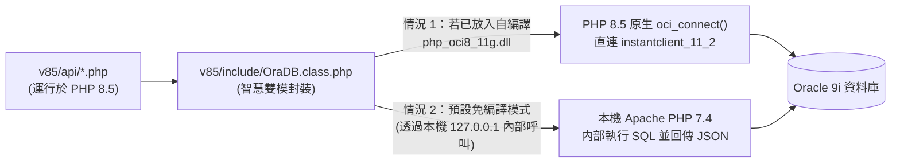

# LAH-API 漸進式升級 PHP 8.5（`v85` 雙軌架構）完整技術與實作手冊

> **文件版本**：v1.0  
> **適用專案**：`LAH-API`（`c:\Temp\DEV\LAH-Workspace\LAH-API\`）  
> **目標架構**：Apache 2.4 (`mod_php7` + `mod_proxy_fcgi`) ＋ PM2 託管 PHP 8.5 FastCGI (`/v85/`) ＋ Oracle 9i / SQLite 3  

---

## 第一章：整體升級策略與系統架構藍圖

### 1.1 核心設計決策
因應近期 Windows 環境下之 PHP 安全事件（如 PHP2Shell / CVE-2024-4577 等舊版漏洞），本計畫採取風險最低、維運變動最小的**「絞殺者模式（Strangler Fig Pattern）」漸進式升級**：

1. **新舊並存目錄（`www/` 與 `v85/`）**：
   * 既有 [`LAH-API/www/`](file:///c:/Temp/DEV/LAH-Workspace/LAH-API/www) 維持 PHP 7.3 / 7.4 原狀運作，確保線上地政業務零中斷。
   * 於 [`LAH-API/v85/`](file:///c:/Temp/DEV/LAH-Workspace/LAH-API) 建立全新 PHP 8.5 專屬目錄，逐支檢視、修正並移植 API。
2. **伺服器雙軌分流（方案 B：保留 Apache 2.4 ＋ `mod_proxy_fcgi`）**：
   * **不替換現有 Apache 2.4 服務**，因此各地所現有的防火牆規則、SSL 憑證與自動更新部署工具 [`LAH-Updater/updater.py`](file:///c:/Temp/DEV/LAH-Workspace/LAH-Updater/updater.py) 均無需大幅改動。
   * Apache 2.4 繼續以 `mod_php7` 處理舊版 `/` 請求；同時啟用 Apache 內建的 `mod_proxy_fcgi` 模組，將 `/v85/`（或已移植之 API）透過本機迴路轉發至 `127.0.0.1:9085` 的 **PHP 8.5 FastCGI** 服務。
3. **進程高可用守護（PM2 託管 `php-cgi.exe`）**：
   * 由於 Windows 版 PHP 無原生 `php-fpm`，直接使用各所伺服器已安裝之 **PM2** 守護 `C:\Tools\php85\php-cgi.exe`，解決 Windows 下 `php-cgi.exe` 滿載自動退出造成的 `502 Bad Gateway` 問題。

### 1.2 雙軌運作架構拓撲圖



---

## 第二章：Node.js v16 限制、PM2 託管與 `nvm-windows` 完整解析

您擔心：**「伺服器上的 Node.js 因 `LAH-FE` (Nuxt 2) 限制鎖在 v16，若要用 PM2 管理 PHP 8.5 服務，是否需要用 `nvm` 克服？」**

### 2.1 核心結論：PM2 託管 PHP 8.5 **完全不受 Node.js v16 限制**！

1. **為什麼不需要為了 PHP 8.5 升級 Node.js？**
   * PM2 雖然本身是用 Node.js 寫的守護程式，但當它管理非 Node.js 程式（如 `php-cgi.exe`、Python、Go 執行檔）時，只需在設定檔指定 `interpreter: "none"`。
   * 此時 PM2 只負責透過 Windows OS API 啟動 `C:\Tools\php85\php-cgi.exe`、監聽其 Process ID (PID)，並在它崩潰或退出時於 100 毫秒內自動重啟。
   * 因此，**您現有跑在 Node.js v16 上的 PM2，可以直接把 PHP 8.5 (`php-cgi.exe`) 納管進同一個 `pm2 list` 面板中**，跟 `LAH-FE` (Node 16) 完全相安無事！

### 2.2 若未來同台伺服器確實需要「多版本 Node.js 共存」（例如 Node 16 + Node 22），`nvm-windows` 該怎麼用才不會踩坑？

如果您未來因為其他專案或新版工具，想在同一台 Windows 伺服器安裝 `nvm-windows`，**千萬不要在背景服務依賴 `nvm use <version>` 指令**！

* ⚠️ **`nvm-windows` 的底層陷阱**：
  在 Windows 上，執行 `nvm use 22` 的原理是把系統全域捷徑 `C:\Program Files\nodejs` 指到 v22 目錄。如果此時 `LAH-FE` 被 PM2 自動重啟，它就會誤抓到 Node 22 而啟動失敗！
* ✅ **正確的 `nvm-windows` + PM2 多版本共存做法**：
  用 `nvm install 16.20.2` 與 `nvm install 22.14.0` 下載好各版本後，**在 PM2 的 `ecosystem.config.js` 中，直接將 `interpreter` 指向該版本 `node.exe` 的實體絕對路徑**，繞過全域捷徑：

```javascript
// 檔案位置範例：c:\Temp\DEV\LAH-Workspace\LAH-API\v85\ecosystem.config.js
module.exports = {
  apps: [
    // 1. 新增的 LAH-API v85 (PHP 8.5 FastCGI 服務)
    {
      name: "lah-api-v85",
      script: "C:\\Tools\\php85\\php-cgi.exe",
      args: "-b 127.0.0.1:9085 -c C:\\Tools\\php85\\php.ini",
      cwd: "C:\\Temp\\DEV\\LAH-Workspace\\LAH-API\\v85",
      interpreter: "none",          // 關鍵：告知 PM2 這是原生 .exe，不透過 node 執行
      exec_mode: "fork",
      instances: 1,                 // Windows 下由 PHP_FCGI_CHILDREN 控制內部子程序數
      autorestart: true,            // 當滿 10000 次請求自動退出或崩潰時，PM2 立即無縫重啟
      watch: false,
      max_memory_restart: "1G",
      env: {
        // 將 Oracle Instant Client 注入環境變數
        PATH: "C:\\Tools\\instantclient_11_2;C:\\Tools\\php85;" + process.env.PATH,
        NLS_LANG: "American_America.US7ASCII",
        // Windows PHP-CGI 穩定度關鍵參數：允許併發子程序與拉高回收門檻
        PHP_FCGI_CHILDREN: "16",
        PHP_FCGI_MAX_REQUESTS: "10000"
      }
    }

    /* 
    // (補充範例) 若同台機器透過 nvm-windows 跑不同 Node 版本的服務，直接綁定實體路徑即可：
    ,{
      name: "lah-fe-nuxt2",
      script: "node_modules/nuxt/bin/nuxt.js",
      args: "start",
      cwd: "C:\\Temp\\DEV\\LAH-Workspace\\LAH-FE",
      interpreter: "C:\\Users\\Administrator\\AppData\\Roaming\\nvm\\v16.20.2\\node.exe"
    }
    */
  ]
};
```

---

## 第三章：破解「PHP 8.5 ↔ Oracle 9i」雙重死結的實戰方案

### 3.1 問題根因回顧（為什麼不能直接拿 PHP 8.5 官方 DLL 連 Oracle 9i？）

1. **Oracle 9i 伺服器的限制**：
   Oracle 官方自 Instant Client 12c 起，在底層 `oci.dll` 移除了對 Oracle 9i (`9.2`) 的網路協定支援。只要用 12c / 19c Client 連 Oracle 9i，必定拋出：
   `ORA-03134: Connections to this server version are no longer supported.`
   因此，連線至 Oracle 9i **唯一合法的客戶端只有 `instantclient_11_2` (`11.2.0.4`)**。
2. **PHP 8.5 Windows 官方 DLL 的限制**：
   * PHP 8.4 / 8.5 官方預編譯套件僅提供 `php_oci8_12c.dll` 與 `php_oci8_19.dll`（不再提供預編譯的 `php_oci8_11g.dll`）。
   * 經二進位拆解驗證，`php_oci8_12c.dll` 在啟動時會強制向 `oci.dll` 尋找 Oracle 12c 才新增的 C 函式 **`OCIStmtGetNextResult`**。
   * 由於 `instantclient_11_2\oci.dll` 沒有該函式，PHP 8.5 載入 `php_oci8_12c.dll` 配 `instantclient_11_2` 時會直接失敗。

### 3.2 三階段解決方案（由簡入繁，雙軌期立即可通）

由於 [`LAH-API`](file:///c:/Temp/DEV/LAH-Workspace/LAH-API/README.md) 所有 Oracle 查詢 100% 封裝於 [`www/include/OraDB.class.php`](file:///c:/Temp/DEV/LAH-Workspace/LAH-API/www/include/OraDB.class.php) 單一類別中，我們在 `v85/include/OraDB.class.php` 設計**「智慧雙模連線」**，讓您完全不必被 DLL 卡住：



| 方案選項 | 運作方式 | 優缺點與適用時機 |
| :--- | :--- | :--- |
| **方案 1（推薦起步）：<br>本機 `127.0.0.1` 內部橋接模式** | 在雙軌並行期間，Apache 本來就有載入 `mod_php7` + `instantclient_11_2`。當 `v85/` (PHP 8.5) 的 `OraDB.class.php` 發現環境未載入 `oci8` 時，自動將 SQL 與 Bind 參數透過本機迴路 `http://127.0.0.1/internal_ora_bridge.php`（僅限 `127.0.0.1` 存取）交由 PHP 7 查出結果並轉回陣列。 | ✅ **零編譯成本、5 分鐘搞定**。<br>✅ 對外 API、Session、檔案處理、SQLite 快取 100% 跑在 PHP 8.5。<br>✅ 所有 30 支業務 API 程式碼與 SQL `:bv_` 綁定**一行都不用改**！ |
| **方案 2（純 PHP 8.5 免編譯）：<br>Windows ODBC 橋接 (`pdo_odbc`)** | 在 `instantclient_11_2` 安裝官方 `instantclient-odbc-windows.x64-11.2.0.4.0.zip`，PHP 8.5 開啟內建的 `extension=odbc` 與 `extension=pdo_odbc`，透過 Windows `odbc32.dll` 呼叫 11.2 Driver 連 Oracle 9i。 | ✅ 可完全移除 PHP 7，純 PHP 8.5 單一進程運作。<br>⚠️ 需在 `v85/include/OraDB.class.php` 內將 `:bv_name` 自動轉為 `?` 位置參數。 |
| **方案 3（純 PHP 8.5 原生）：<br>VS2022 自編譯 `php_oci8_11g.dll`** | 下載 PECL `oci8-3.4.x` C 原始碼（內部仍保留 `#if OCI_MAJOR_VERSION >= 12` 判斷），使用 Visual Studio 2022 + `instantclient_11_2\sdk` 編譯出 PHP 8.5 專用之 `php_oci8_11g.dll`。 | ✅ 效能最高、100% 原生 `oci_*` 函式。<br>⚠️ 需建置一次 C++ 編譯環境（約 1~2 小時）。 |

---

## 第四章：`LAH-API\v85\` 目錄結構與共用資源設計

### 4.1 為什麼要共用 `.env` 與 `assets/db/`？
在漸進移植期間，部分 API 跑在 `www/` (PHP 7)，部分 API 跑在 `v85/` (PHP 8.5)。若兩邊各自擁有一份 SQLite 資料庫（`dimension.db`、`cache.db`、`RKEYN.db`），會造成**使用者權限、系統設定與快取不同步**。因此，`v85/` 僅隔離 PHP 程式碼與 `vendor/`，底層資料一律指向 `www/`：

```text
c:\Temp\DEV\LAH-Workspace\LAH-API\
├── www/                                # [既有 PHP 7 目錄] 維持現狀
│   ├── .env                            # ★ 共用環境變數檔 (MOCK=true 等)
│   ├── assets/
│   │   ├── db/                         # ★ 共用 SQLite 資料庫 (LAH.db, dimension.db, cache.db)
│   │   ├── files/                      # ★ 共用 SQL 樣板 (.tpl)
│   │   └── xlsx/                       # ★ 共用 Excel 匯出樣板
│   ├── log/                            # ★ 共用日誌目錄
│   ├── include/                        # 舊版 PHP 7 類別庫
│   └── api/                            # 舊版 PHP 7 API 端點
│
└── v85/                                # [新版 PHP 8.5 專屬目錄]
    ├── ecosystem.config.js             # PM2 啟動 PHP 8.5 FastCGI 設定檔
    ├── composer.json                   # PHP 8.5 專用套件宣告 (PhpSpreadsheet ^2.0)
    ├── vendor/                         # PHP 8.5 專用 Composer 依賴目錄
    ├── ver.php                         # PHP 8.5 雙軌健康檢查端點 (/v85/ver.php)
    ├── include/                        # 修正 PHP 8.5 相容性後之核心類別
    │   ├── init.php
    │   ├── Env.class.php
    │   ├── GlobalConstants.inc.php     # 定義 V85_ROOT_DIR 與共用 LEGACY_WWW_DIR
    │   ├── GlobalFunctions.inc.php
    │   ├── System.class.php
    │   └── OraDB.class.php
    └── api/                            # 逐支移植過來的 API 端點 (/v85/api/*.php)
```

### 4.2 `v85/include/GlobalConstants.inc.php` 路徑常數對齊寫法

```php
<?php
// v85 專屬程式碼根目錄：c:\Temp\DEV\LAH-Workspace\LAH-API\v85
define('V85_ROOT_DIR', dirname(__DIR__));
// 指向既有 www 目錄以共用資料庫與資產：c:\Temp\DEV\LAH-Workspace\LAH-API\www
define('ROOT_DIR', dirname(V85_ROOT_DIR) . DIRECTORY_SEPARATOR . 'www');

// 類別引入走 v85/include，其餘資產與 SQLite 資料庫與 www 完全共用
define('INC_DIR', V85_ROOT_DIR . DIRECTORY_SEPARATOR . 'include');
define('ASSETS_DIR', ROOT_DIR . DIRECTORY_SEPARATOR . 'assets');
define('EXPORT_DIR', ROOT_DIR . DIRECTORY_SEPARATOR . 'export');
define('IMPORT_DIR', ROOT_DIR . DIRECTORY_SEPARATOR . 'import');
define('LOG_DIR', ROOT_DIR . DIRECTORY_SEPARATOR . 'log');
define('DB_DIR', ASSETS_DIR . DIRECTORY_SEPARATOR . 'db');
define('DEF_SQLITE_DB', DB_DIR . DIRECTORY_SEPARATOR . 'LAH.db');
```
*(同時在 `v85/include/Env.class.php` 中預設讀取 `ROOT_DIR . '/.env'`，即可無縫讀取同一份 `www/.env`！)*

---

## 第五章：`LAH-API` 移植至 PHP 8.5 程式碼修改檢核表（Code Audit）

將檔案從 `www/` 複製到 `v85/` 時，請依下表修正 PHP 8.0 ~ 8.5 的語法不相容與棄用項目：

### 5.1 [`v85/include/init.php`](file:///c:/Temp/DEV/LAH-Workspace/LAH-API/www/include/init.php#L11-L14)（必改：修正 Session Cookie 參數）
* **原因**：PHP 8.0 起 `session_set_cookie_params()` 傳入陣列時，Key **必須全小寫**（寫 `"SameSite"` 會報錯），且重複呼叫會互相覆蓋。
* **修改前（`www/include/init.php` 第 11~14 行）**：
  ```php
  session_set_cookie_params(["SameSite" => "None"]); //none, lax, strict
  session_set_cookie_params(["Secure" => "false"]); //false, true
  session_set_cookie_params(["HttpOnly" => "true"]); //false, true
  session_start();
  ```
* **修改後（`v85/include/init.php`）**：
  ```php
  session_set_cookie_params([
      'samesite' => 'Lax',
      'secure'   => false,
      'httponly' => true
  ]);
  session_start();
  ```

### 5.2 修正 `${var}` 舊式字串插值語法（PHP 8.2+ 棄用）
* **原因**：PHP 8.2 起在雙引號字串中使用 `"${var}"`（`$` 在大括號外）會噴 `Deprecated: Using ${var} in strings is deprecated, use {$var} instead`。
* **受影響檔案清單**：
  1. [`System.class.php`](file:///c:/Temp/DEV/LAH-Workspace/LAH-API/www/include/System.class.php#L626-L664)（第 626, 633, 640, 646, 652, 658, 664 行）：
     將 `(HOST=${ip})(PORT=${port})))(CONNECT_DATA=(SERVICE_NAME=${site}WEB))` 改為 `(HOST={$ip})(PORT={$port})))(CONNECT_DATA=(SERVICE_NAME={$site}WEB))`。
  2. [`MSDB.class.php`](file:///c:/Temp/DEV/LAH-Workspace/LAH-API/www/include/MSDB.class.php#L48)（第 48 行）：`${key}` 改為 `{$key}`。
  3. [`Logger.class.php`](file:///c:/Temp/DEV/LAH-Workspace/LAH-API/www/include/Logger.class.php#L99-L101)（第 99, 101 行）：`log-${date}.zip` 改為 `log-{$date}.zip`。
  4. [`GlobalFunctions.inc.php`](file:///c:/Temp/DEV/LAH-Workspace/LAH-API/www/include/GlobalFunctions.inc.php#L181-L224)（第 181, 193, 212, 224 行）：`${zipcreated}` 改為 `{$zipcreated}`。
  5. [`DocUserInfo.class.php`](file:///c:/Temp/DEV/LAH-Workspace/LAH-API/www/include/DocUserInfo.class.php#L55-L77)、[`IPResolver.class.php`](file:///c:/Temp/DEV/LAH-Workspace/LAH-API/www/include/IPResolver.class.php#L309)、[`Message.class.php`](file:///c:/Temp/DEV/LAH-Workspace/LAH-API/www/include/Message.class.php#L146-L236)、[`MOIEXP.class.php`](file:///c:/Temp/DEV/LAH-Workspace/LAH-API/www/include/MOIEXP.class.php#L240-L361)：全數將 `${...}` 替換為 `{$...}`。

### 5.3 修正 PHP 8.4 / 8.5 最新棄用函式（`curl_close`、`imagedestroy`、`E_USER_ERROR`、`utf8_decode`）

| 檔案名稱 | 行號 | 舊寫法（PHP 7.3） | PHP 8.5 修正寫法 | 原因說明 |
| :--- | :--- | :--- | :--- | :--- |
| [`OraDB.class.php`](file:///c:/Temp/DEV/LAH-Workspace/LAH-API/www/include/OraDB.class.php#L110) | L110, 141, 152 | `trigger_error(..., E_USER_ERROR);` | `throw new \RuntimeException($e['message']);` | PHP 8.4+ 正式棄用 `trigger_error` 搭配 `E_USER_ERROR` |
| [`GlobalFunctions.inc.php`](file:///c:/Temp/DEV/LAH-Workspace/LAH-API/www/include/GlobalFunctions.inc.php#L130) | L130 | `imagedestroy($image);` | `unset($image);`（或直接移除） | **PHP 8.5 最新棄用**：`GdImage` 物件會自動釋放記憶體 |
| [`GlobalFunctions.inc.php`](file:///c:/Temp/DEV/LAH-Workspace/LAH-API/www/include/GlobalFunctions.inc.php#L380)<br>[`ADService.class.php`](file:///c:/Temp/DEV/LAH-Workspace/LAH-API/www/include/ADService.class.php#L986)<br>[`DGXLandCaseParser.class.php`](file:///c:/Temp/DEV/LAH-Workspace/LAH-API/www/include/DGXLandCaseParser.class.php#L569)<br>[`MOISMS.class.php`](file:///c:/Temp/DEV/LAH-Workspace/LAH-API/www/include/MOISMS.class.php#L62) | 各檔 cURL 結尾處 | `curl_close($ch);` | `unset($ch);`（或直接移除） | **PHP 8.5 最新棄用**：`CurlHandle` 物件自 PHP 8.0 起已改為自動回收，`curl_close` 在 PHP 8.5 觸發 Deprecated 警告 |
| [`SQLSRV_DataBase.class.php`](file:///c:/Temp/DEV/LAH-Workspace/LAH-API/www/include/SQLSRV_DataBase.class.php#L286) | L286, 321, 399, 438 | `utf8_decode($value)` | `mb_convert_encoding($value, 'ISO-8859-1', 'UTF-8')` | PHP 8.2+ 棄用 `utf8_decode()` |

---

## 第六章：Apache 2.4 (`httpd.conf`) `mod_proxy_fcgi` 雙軌設定詳解

在保留現有 Apache 2.4 (`mod_php7`) 的前提下，只需在 `httpd.conf` 進行以下 2 步微調，即可將 `/v85` 流量導向 PM2 管理的 PHP 8.5 FastCGI (`127.0.0.1:9085`)：

### 6.1 步驟 1：取消註解啟用 Proxy 與 FastCGI 模組
打開 Apache 的 `conf/httpd.conf`（參考 [`LAH-API/httpd.conf-ref`](file:///c:/Temp/DEV/LAH-Workspace/LAH-API/httpd.conf-ref#L148-L166) 第 148~166 行），確認以下三個模組前方的 `#` 已移除：

```apache
LoadModule proxy_module modules/mod_proxy.so
LoadModule proxy_fcgi_module modules/mod_proxy_fcgi.so
LoadModule rewrite_module modules/mod_rewrite.so
```

### 6.2 步驟 2：在 `httpd.conf` 最下方加入 `/v85` 雙軌分流設定
將以下設定區塊加在 `httpd.conf` 尾端（請依實際路徑調整 `c:/Temp/DEV/LAH-Workspace/LAH-API`）：

```apache
# =====================================================================
# LAH-API v85 (PHP 8.5 FastCGI via PM2 on 127.0.0.1:9085) 雙軌設定
# =====================================================================

# 1. 將 /v85 虛擬路徑映射至實體 LAH-API/v85 目錄
Alias /v85 "c:/Temp/DEV/LAH-Workspace/LAH-API/v85"

<Directory "c:/Temp/DEV/LAH-Workspace/LAH-API/v85">
    Header set Access-Control-Allow-Origin "*"
    Options Indexes FollowSymLinks
    AllowOverride None
    Require all granted

    # 關鍵：在 v85 目錄下，攔截所有 .php 請求，改由 PHP 8.5 FastCGI (9085) 處理，不走 mod_php7！
    <FilesMatch "\.php$">
        # 安全防護：確認實體 .php 檔案存在才轉發，徹底阻絕 CGI 路徑注入 (CVE-2024-4577 等)
        <If "-f %{REQUEST_FILENAME}">
            SetHandler "proxy:fcgi://127.0.0.1:9085/"
            ProxyFCGISetEnvIf "reqenv('SCRIPT_FILENAME') =~ m#^proxy:fcgi://127\.0\.0\.1:9085/(.*)$#" SCRIPT_FILENAME "$1"
        </If>
    </FilesMatch>
</Directory>

# 設定 FastCGI 逾時時間為 300 秒（避免跨所大筆地籍查詢 Timeout）
<Proxy "fcgi://127.0.0.1:9085/" enablereuse=on max=16>
    ProxySet timeout=300
</Proxy>
```

> [!TIP]
> **進階功能：想讓前端不用改網址就能自動吃到 `v85` 已移植的 API 嗎？**
> 只要在原本 `<Directory ".../LAH-API/www">` 區塊內加上以下 5 行 Rewrite 規則：當前端呼叫 `/api/reg_json_api.php` 時，Apache 會先偷看 `v85/api/reg_json_api.php` 存不存在；**若存在就自動轉給 PHP 8.5 執行，若還沒搬過去就繼續給原本的 PHP 7 執行**！
> ```apache
> RewriteEngine On
> RewriteCond "c:/Temp/DEV/LAH-Workspace/LAH-API/v85%{REQUEST_URI}" -f
> RewriteRule ^/(.*\.php)$ "fcgi://127.0.0.1:9085/c:/Temp/DEV/LAH-Workspace/LAH-API/v85/$1" [P,L]
> ```

---

## 第七章：開發筆電（`c:\Temp\DEV\LAH-Workspace`）實作步驟 Step-by-Step

以下步驟專為您的開發筆電量身打造，與您現有的 `C:\Tools\php74` 及 [`start_dev.bat`](file:///c:/Temp/DEV/LAH-Workspace/start_dev.bat) 完全相容：

### Step 1：準備 PHP 8.5 (NTS x64) 執行環境
1. 前往 [windows.php.net/download](https://windows.php.net/download/) 下載 **PHP 8.5 (8.5.x) VS17 x64 Non Thread Safe (NTS)** `.zip` 壓縮包。
2. 解壓縮至 `C:\Tools\php85\`（確認 `C:\Tools\php85\php-cgi.exe` 存在）。
3. 複製 `C:\Tools\php85\php.ini-development` 為 `C:\Tools\php85\php.ini`，並修改以下關鍵設定：
   ```ini
   extension_dir = "C:/Tools/php85/ext"
   date.timezone = "Asia/Taipei"
   memory_limit = 512M
   max_execution_time = 300
   display_errors = On
   error_reporting = E_ALL

   ; 開啟 LAH-API 所需擴充套件
   extension=curl
   extension=fileinfo
   extension=gd
   extension=intl
   extension=mbstring
   extension=odbc
   extension=openssl
   extension=pdo_odbc
   extension=pdo_sqlite
   extension=sqlite3
   extension=sockets
   extension=zip
   ```
4. 在 PowerShell 驗證 PHP 8.5 是否正常運作：
   ```powershell
   C:\Tools\php85\php.exe -v
   C:\Tools\php85\php.exe -m
   ```

### Step 2：建立 `LAH-API\v85\` 目錄與測試端點
1. 將先前建立的空目錄 `v1` 重新命名為 `v85`：
   ```powershell
   Rename-Item -Path "c:\Temp\DEV\LAH-Workspace\LAH-API\v1" -NewName "v85"
   ```
2. 在 `c:\Temp\DEV\LAH-Workspace\LAH-API\v85\ver.php` 建立第一支 PHP 8.5 驗證腳本：
   ```php
   <?php
   header('Content-Type: application/json; charset=utf-8');
   echo json_encode([
       'status' => 1,
       'channel' => 'v85',
       'php_version' => PHP_VERSION,
       'sapi' => PHP_SAPI,
       'extensions' => [
           'pdo_sqlite' => extension_loaded('pdo_sqlite'),
           'sqlite3'    => extension_loaded('sqlite3'),
           'intl'       => extension_loaded('intl'),
           'curl'       => extension_loaded('curl'),
           'gd'         => extension_loaded('gd'),
           'oci8'       => extension_loaded('oci8'),
           'odbc'       => extension_loaded('odbc'),
       ],
       'timestamp' => date('Y-m-d H:i:s')
   ], JSON_PRETTY_PRINT | JSON_UNESCAPED_UNICODE);
   ```

### Step 3：使用 PM2 啟動 PHP 8.5 FastCGI 服務 (`127.0.0.1:9085`)
1. 將第二章的 `ecosystem.config.js` 存放在 `c:\Temp\DEV\LAH-Workspace\LAH-API\v85\ecosystem.config.js`。
2. 在 PowerShell 啟動 PM2 服務（直接使用您現有的 Node v16 環境即可）：
   ```powershell
   cd c:\Temp\DEV\LAH-Workspace\LAH-API\v85
   pm2 start ecosystem.config.js
   pm2 status
   ```
3. 確認 Port `9085` 已開始監聽：
   ```powershell
   Get-NetTCPConnection -LocalPort 9085 -State Listen
   ```

### Step 4：在 Apache 2.4（或筆電獨立測試埠）驗收雙軌分流
* **情境 A（筆電已安裝並啟動 Apache 2.4）**：
  依第六章設定好 `httpd.conf` 並重啟 Apache 後，開啟瀏覽器分別測試：
  * `http://127.0.0.1/ver.php` 👉 由舊版 `mod_php7` 回應（顯示 PHP 7.3 / 7.4）。
  * `http://127.0.0.1/v85/ver.php` 👉 由 Apache `mod_proxy_fcgi` 轉發給 PM2 的 PHP 8.5 回應（顯示 `"php_version": "8.5.x"`, `"sapi": "cgi-fcgi"`）！
* **情境 B（筆電平時沒開 Apache，而是用 `start_dev.bat` 內建伺服器）**：
  在筆電日常不開 Apache 時，也可隨時直接用 PHP 8.5 內建伺服器在 Port `8085` 快速測試 `v85/`：
  ```powershell
  C:\Tools\php85\php.exe -S 127.0.0.1:8085 -t c:\Temp\DEV\LAH-Workspace\LAH-API\v85
  ```
  瀏覽器打開 `http://127.0.0.1:8085/ver.php` 即可立即驗證。

### Step 5：推薦的漸進移植順序
1. **第一批（系統基底）**：`v85/include/` 下的 `Env.class.php`、`GlobalConstants.inc.php`、`GlobalFunctions.inc.php`、`init.php`、`System.class.php`、`OraDB.class.php`、`Cache.class.php`、`SQLite*.class.php`。
2. **第二批（無外部複雜依賴之核心 API）**：
   * `v85/api/auth_json_api.php`（登入與權限驗證）
   * `v85/api/query_json_api.php`（通用系統看板查詢）
   * `v85/api/system_json_api.php`（系統設定與代碼同步）
3. **第三批（地政核心業務 API）**：
   * `v85/api/reg_json_api.php`（登記案件）
   * `v85/api/sur_json_api.php`（測量案件）
   * `v85/api/moicas_json_api.php`（跨所與智慧控管查詢）
   * `v85/api/stats_json_api.php`、`v85/api/notification_json_api.php`
4. **第四批（含 Composer 外部套件與排程）**：
   * 在 `v85/` 執行 `C:\Tools\php85\php.exe composer.phar install` 安裝新版 `phpoffice/phpspreadsheet`。
   * 移植 `v85/api/export_xlsx_api.php`、`v85/api/export_txt_data.php` 與 `v85/task/` 排程腳本。

